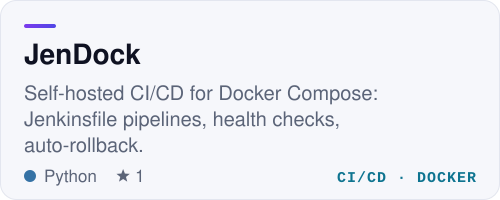
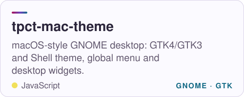
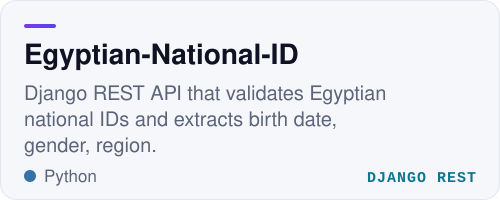
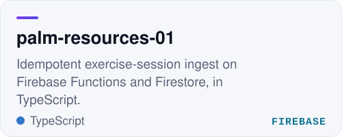

<picture>
  <source media="(prefers-color-scheme: dark)" srcset="./assets/hero-dark.svg">
  
</picture>

 

**I design and build production systems that businesses run on every day: ERP suites, learning and gaming platforms, and the automation behind them.**

 

Case studies and full project history live on the portfolio: <a href="https://tpct.github.io"><b>tpct.github.io</b></a>

## About

- Founder of **[ShiftCodes](https://shiftcodes.net)**, a software studio that builds custom business platforms.
- Systems architect and senior full-stack engineer: Laravel and Python at the core, Docker and Linux on the server.
- I care about modular architecture, clean APIs, role-based access, and delivery pipelines that make shipping safe.

## Stack

| Area | Tools |
|---|---|
| **Languages** | PHP · Python · TypeScript · JavaScript · C# |
| **Backend** | Laravel · Filament · Django / DRF · FastAPI · Node.js · .NET |
| **Frontend** | React · Next.js · Livewire · Tailwind CSS |
| **Data** | PostgreSQL · MySQL / MariaDB · Oracle · Redis · Firestore |
| **Infra & delivery** | Docker · Linux · Nginx · GitHub Actions · CI/CD pipelines |

## Featured projects

<table>
  <tr>
    <td width="50%" valign="top">
      <a href="https://github.com/TPCT/JenDock">
        <picture>
          <source media="(prefers-color-scheme: dark)" srcset="./assets/generated/repo-JenDock-dark.svg">
          
        </picture>
      </a>
    </td>
    <td width="50%" valign="top">
      <a href="https://github.com/TPCT/tpct-mac-theme">
        <picture>
          <source media="(prefers-color-scheme: dark)" srcset="./assets/generated/repo-tpct-mac-theme-dark.svg">
          
        </picture>
      </a>
    </td>
  </tr>
  <tr>
    <td width="50%" valign="top">
      <a href="https://github.com/TPCT/Egyptian-National-ID">
        <picture>
          <source media="(prefers-color-scheme: dark)" srcset="./assets/generated/repo-Egyptian-National-ID-dark.svg">
          
        </picture>
      </a>
    </td>
    <td width="50%" valign="top">
      <a href="https://github.com/TPCT/order-payment-api">
        <picture>
          <source media="(prefers-color-scheme: dark)" srcset="./assets/generated/repo-order-payment-api-dark.svg">
          
        </picture>
      </a>
    </td>
  </tr>
  <tr>
    <td width="50%" valign="top">
      <a href="https://github.com/TPCT/social-media-scheduler">
        <picture>
          <source media="(prefers-color-scheme: dark)" srcset="./assets/generated/repo-social-media-scheduler-dark.svg">
          
        </picture>
      </a>
    </td>
    <td width="50%" valign="top">
      <a href="https://github.com/TPCT/palm-resources-01">
        <picture>
          <source media="(prefers-color-scheme: dark)" srcset="./assets/generated/repo-palm-resources-01-dark.svg">
          
        </picture>
      </a>
    </td>
  </tr>
</table>

## Selected private work

Most of my commercial work is private because it runs real client operations. These are the kinds of products I build:

<table>
  <tr>
    <td width="50%" valign="top">
      <b>Business suites</b> 
      ERP · HRM · POS · CRM 
      Modular platforms for operations, people, sales and customers, with role-based access and reporting.
    </td>
    <td width="50%" valign="top">
      <b>Learning platforms</b> 
      LMS 
      Course delivery, enrolment and progress tracking for training businesses.
    </td>
  </tr>
  <tr>
    <td width="50%" valign="top">
      <b>Gaming platform &amp; bots</b> 
      Platform · Bots · Automation 
      A platform back end, plus the bots and automation that run community and game operations.
    </td>
    <td width="50%" valign="top">
      <b>OCR &amp; document processing</b> 
      OCR · Pipelines 
      Pipelines that turn scanned documents into structured, searchable data.
    </td>
  </tr>
  <tr>
    <td width="50%" valign="top">
      <b>eSIM platform</b> 
      Telecom · Provisioning 
      Ordering, provisioning and account management for digital SIM products.
    </td>
    <td width="50%" valign="top">
      <b>Monitoring &amp; CI tooling</b> 
      DevOps · Observability 
      Self-hosted deploy pipelines, health checks and alerting for production services.
    </td>
  </tr>
</table>

## GitHub stats

<picture>
  <source media="(prefers-color-scheme: dark)" srcset="./assets/generated/stats-dark.svg">
  
</picture>

Generated daily from the GitHub API by a workflow in this repository.

## Contact

Open to architecture work, platform builds and technical partnerships.

**Email** [eslamjackie@outlook.com](mailto:eslamjackie@outlook.com) · **Studio** [shiftcodes.net](https://shiftcodes.net) · **Portfolio** [tpct.github.io](https://tpct.github.io)
